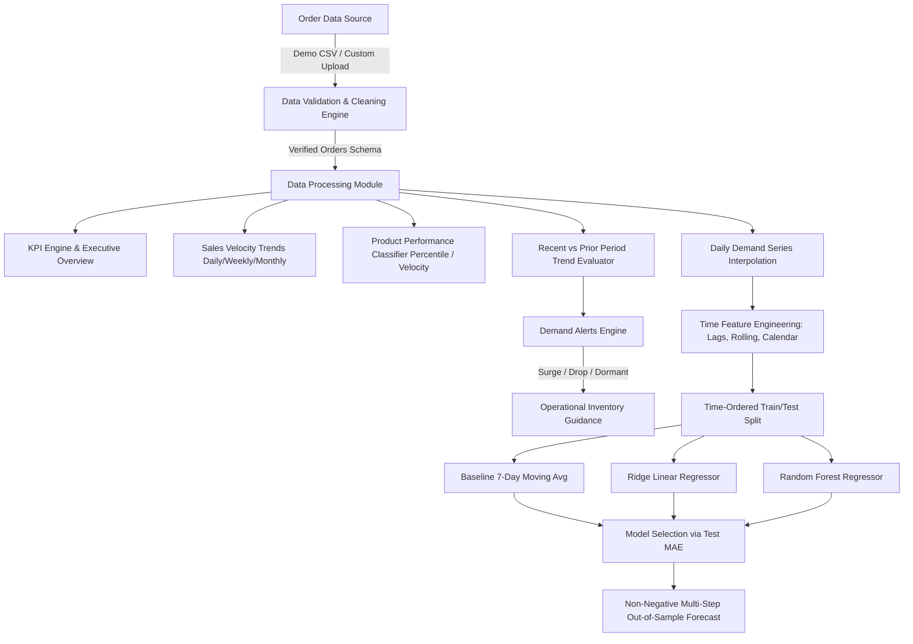

# PS-04: E-Commerce Product Demand Analysis
### *Smart Sales Insights & Inventory Planning*
**B.Tech Computer Science & Engineering Capstone Project**

---

## 📖 Executive Summary
In modern retail supply chains, stockouts lead to lost revenue while excess inventory inflates warehousing costs and ties up working capital. **PS-04: E-Commerce Product Demand Analysis** is an end-to-end, presentation-ready analytical and machine learning web application built in Python and Streamlit.

The application ingests historical order transactions, analyzes multi-dimensional sales velocities, mathematically classifies inventory items (Best-Selling, Moderate-Selling, and Slow-Moving), generates intelligent demand surge/drop alerts with actionable inventory guidance, and forecasts future product-level demand using a time-ordered Machine Learning pipeline.

---

## 🛠️ Technology Stack
- **Web Interface**: [Streamlit](https://streamlit.io/) (with responsive CSS cards, badges, and layout)
- **Data Engineering**: [Pandas](https://pandas.pydata.org/), [NumPy](https://numpy.org/)
- **Visual Analytics**: [Plotly](https://plotly.com/python/) (interactive dual-axis charts, donut breakdowns, scatter portfolios)
- **Machine Learning**: [Scikit-learn](https://scikit-learn.org/) (Ridge Regression, Random Forest Regressor, TimeSeries validation)
- **Data Storage**: CSV (reproducible synthetic dataset generator & user upload validation)
- **Environment**: Python 3.11+ / Windows OS compatible

---

## 📂 Project Architecture & Directory Structure
```
e commerce product/
├── app.py                   # Streamlit web application & UI orchestrator
├── data_generator.py        # Reproducible synthetic orders generator (1,945+ records)
├── data_processing.py       # Data validation, KPI calculations, aggregations, classification
├── demand_forecasting.py    # Time-ordered ML forecasting pipeline (Ridge vs RF vs Baseline)
├── demand_alerts.py         # Diagnostic alert engine with actionable inventory recommendations
├── test_app.py              # Automated unit and integration test suite (22 tests)
├── requirements.txt         # Package dependencies specification
├── README.md                # Comprehensive documentation, setup guide & viva prep
└── data/
    └── demo_orders.csv      # Verified demo dataset (1,945 orders across 5 categories)
```

### System Data Flow


---

## 🔍 Core Features & Mathematical Formulations

### 1. Transparent Product Performance Classification
Products are categorized using an objective, configurable mathematical rule rather than arbitrary labeling:
- **Percentile Ranking Mode**:
  - **Best-Selling**: Products in the top 75th percentile ($P_{75}$) of total units sold.
  - **Slow-Moving**: Products in the bottom 30th percentile ($P_{30}$) of total units sold.
  - **Moderate-Selling**: Products between $P_{30}$ and $P_{75}$.
- **Daily Sales Velocity Mode**:
  - $\text{Daily Velocity} = \frac{\text{Total Units Sold}}{\text{Active Analysis Days}}$
  - Configurable thresholds (e.g., $\ge 1.5$ units/day = Best-Seller; $< 0.4$ units/day = Slow-Mover).

### 2. Demand Trend Analysis
Compares order volumes between a **Recent Window** (last $W$ days) and an equivalent contiguous **Prior Baseline Window** (prior $W$ days):
$$\Delta\% = \frac{\text{Recent Units} - \text{Prior Units}}{\text{Prior Units}} \times 100$$
- **Minimum Volume Safeguard**: To prevent statistical noise (e.g., 1 unit increasing to 2 units causing a misleading 100% surge alert), a minimum baseline threshold ($N \ge 5$ units) is required before triggering percentage surge or drop alerts.
- **Zero-Baseline Handling**: Products with 0 prior units and $>0$ recent units are flagged as *New Velocity / Resurgent* rather than producing division-by-zero runtime exceptions.

### 3. Machine Learning Demand Forecasting Module
- **Daily Resampling**: Creates a complete continuous calendar series; inactive sales days are filled with 0.
- **Feature Engineering (No Target Leakage)**:
  - Calendar attributes: `dayofweek`, `month`, `day`, `is_weekend`
  - Autoregressive lag features: `lag_1`, `lag_7`, `lag_14`
  - Rolling window indicators: 7-day rolling mean and standard deviation strictly shifted by 1 day ($t-1$) so future information is never leaked into training features.
- **Strict Chronological Split**: The final 14 days are held out as a validation test set (no random shuffling).
- **Candidate Models**: Evaluates a 7-day Moving Average Baseline against Ridge Linear Regression and Random Forest Regressor. The superior model is selected based on validation **Mean Absolute Error (MAE)**.
- **Non-Negative Post-Processing**: All predictions are bounded using $\max(0, \hat{y})$ (`np.clip(..., 0, None)`) to eliminate impossible negative demand projections.
- **Graceful Fallback**: If a product has fewer than 21 days of transactional history, the pipeline falls back to an empirical moving average baseline with an explanatory notice.

### 4. Operational Demand Alerts & Inventory Guidance
- **Surging Demand (High / Medium Severity)**: Recommends verifying supplier lead times, inspecting warehouse safety buffer stock, and reviewing reorder points.
- **Plummeting Demand (Medium Severity)**: Recommends holding off on restocking, reviewing carrying costs, and considering promotional discounts or bundle campaigns.
- **Dormant / Low Velocity (Low Severity)**: Recommends evaluating product listing visibility, pricing, or catalog phase-out.
- **Scope Limitation Disclaimer**: Order data records customer purchases only; physical warehouse stock-on-hand and supplier lead times are not present in sales logs. Therefore, alerts trigger inventory review recommendations rather than asserting physical stockouts.

### 5. Robust Data Validation & Upload
- Validates required columns: `order_id`, `order_date`, `product_id`, `product_name`, `category`, `quantity`, `unit_price`, `total_sales`.
- Rejects negative/zero quantities and unit prices.
- Parses diverse date formats safely.
- Recalculates and verifies `total_sales = quantity * unit_price`.
- Provides a downloadable CSV template.

---

## 🚀 Setup & Execution Guide (Windows)

### Prerequisites
- Python 3.10, 3.11, or 3.14 installed on your Windows machine.
- PowerShell or Windows Command Prompt.

### Step 1: Open Terminal in Project Directory
```powershell
cd "c:\Users\arav1\OneDrive\Scans\Desktop\e commerce product"
```

### Step 2: Install Dependencies
```powershell
pip install -r requirements.txt
```

### Step 3: Run the Automated Test Suite
```powershell
python test_app.py
```
*Expected output: `Ran 22 tests in ~0.9s. OK`*

### Step 4: Launch the Streamlit Web Application
```powershell
streamlit run app.py
```
The application will launch automatically in your default browser at `http://localhost:8501`.

---

## 🧪 Test Suite Results
All core capabilities are covered by 22 automated test cases in `test_app.py`:

| Test Class | Covered Functionality | Status |
| :--- | :--- | :--- |
| `TestDataGenerator` | Reproducibility, schema compliance, total_sales computation, multi-category coverage | **PASS** |
| `TestDataValidation` | Schema verification, empty datasets, negative quantity/price rejection, date parsing, auto-compute total_sales | **PASS** |
| `TestKPIAndAggregations` | Revenue, unit, order totals, best-seller/slow-mover selection, empty DataFrame safety | **PASS** |
| `TestProductClassification` | Percentile ranking thresholds, sales velocity rules, zero sales safety | **PASS** |
| `TestDemandTrends` | Increasing/decreasing demand detection, minimum volume filter, zero baseline handling | **PASS** |
| `TestDemandForecasting` | Sufficient data ML training, 7/14/30 day horizons, non-negative clipping, short history fallback | **PASS** |
| `TestDemandAlerts` | Multi-severity prioritization, surge/drop classification, business limitation disclaimer | **PASS** |

---

## 🎙️ 5-Minute Live Presentation Script

### Minute 1: Problem Statement & Objectives
> *"Good morning respected evaluators. In e-commerce businesses, misjudging customer demand leads directly to inventory stockouts—which mean lost revenue—or excess inventory—which ties up capital in storage costs.*
>
> *Our project, PS-04: E-Commerce Product Demand Analysis, provides automated sales intelligence, portfolio velocity classification, actionable inventory alerts, and predictive machine learning demand forecasting to assist supply chain managers."*

### Minute 2: Dashboard Overview & Global Filters
> *(Navigate to 'Dashboard')*
> *"On the Executive Dashboard, we display key metrics calculated in real-time: Total Revenue ($135K+), Units Sold, Order Count, and Active Products. Notice our high-contrast cards highlighting our velocity leader—Wireless Noise-Cancelling Headphones—and our slow-moving product.*
>
> *Our sidebar offers dynamic multi-dimensional filters for Date Ranges, Categories (Electronics, Fashion, Home & Kitchen, Books, Accessories), and individual Products, updating all visual analytics instantly."*

### Minute 3: Sales Analysis & Product Performance
> *(Navigate to 'Sales Analysis' and 'Product Performance')*
> *"Under Sales Analysis, stakeholders can toggle between Daily, Weekly, and Monthly aggregations with dual-axis charts comparing revenue against unit velocity, alongside category breakdowns and Top 10 rankings.*
>
> *Under Product Performance, instead of arbitrarily labeling items, we implement a documented mathematical rule. Evaluators can switch between Percentile Ranking or Daily Velocity thresholds. The interactive scatter matrix visualizes units sold against revenue, instantly exposing high-margin fast movers versus capital-draining slow movers."*

### Minute 4: Machine Learning Demand Forecasting
> *(Navigate to 'Demand Forecasting')*
> *"For demand forecasting, we built a Scikit-Learn pipeline. When a user selects a product and a 7, 14, or 30-day horizon, the system resamples daily transactions and engineers non-leaking features: day of week, monthly seasonality, and 7-to-14-day lags and rolling statistics.*
>
> *Crucially, we use a strict chronological train/test split rather than random splitting to avoid target leakage. The system compares a 7-day Moving Average baseline against Ridge Regression and Random Forest, selecting the champion model via validation MAE, and bounds predictions with zero clipping to guarantee realistic, non-negative demand estimates."*

### Minute 5: Demand Alerts, Upload Flexibility & Conclusion
> *(Navigate to 'Demand Alerts' and 'Upload Dataset')*
> *"Finally, Demand Alerts automatically scans recent vs prior sales windows. Products with a surge greater than 20% trigger recommendations to review supplier lead times and safety stock, while dropping items prompt promotional bundle suggestions.*
>
> *We explicitly note the business boundary: because order logs do not contain physical warehouse inventory balances, alerts trigger operational reviews rather than false stockout claims. Users can also upload their own transaction CSVs with comprehensive error checking.*
>
> *With 22 automated tests passing, the application is robust, reproducible, and ready for deployment. Thank you, and we welcome your questions!"*

---

## 🎓 Viva Questions & Answers (Examiner Preparation)

#### Q1: Why did you use a chronological split instead of `train_test_split(shuffle=True)` for the forecasting model?
> **Answer:** In time-series forecasting, data points possess temporal autocorrelation. Shuffling data leaks future information into the training set, resulting in artificially optimistic accuracy metrics that fail in real-world deployment. Holding out the final 14 days chronologically mirrors real operational forecasting where the future is unknown.

#### Q2: What features did you engineer for the machine learning model, and how did you prevent target leakage?
> **Answer:** We engineered calendar indicators (`dayofweek`, `month`, `is_weekend`), autoregressive lags (`lag_1`, `lag_7`, `lag_14`), and a 7-day rolling mean and standard deviation. To prevent target leakage, all rolling statistics and lags are strictly shifted by at least 1 day ($t-1$), ensuring the model only computes features using strictly historical observations.

#### Q3: Why is non-negative clipping (`np.clip(..., 0, None)`) necessary in demand forecasting?
> **Answer:** Linear regressors or tree models can occasionally produce negative outputs during downward trend projections or seasonal troughs. In retail inventory, negative physical demand is logically impossible. Clipping predictions at zero prevents erroneous downstream procurement calculations.

#### Q4: How does your system classify products into Best-Selling, Moderate, and Slow-Moving?
> **Answer:** We provide two documented methods:
> 1. **Percentile Ranking**: Top 25% of items by units sold are classified as Best-Selling; bottom 30% are Slow-Moving; the remaining middle 45% are Moderate-Selling.
> 2. **Daily Sales Velocity**: Products with $\ge 1.5$ units sold per day are Best-Selling, while those with $< 0.4$ units/day are Slow-Moving. Both methods adapt dynamically to the filtered date window.

#### Q5: Why do you enforce a minimum sales volume filter in the demand trend calculation?
> **Answer:** Percentage change is highly sensitive to small denominators. For instance, if a niche book sells 1 copy in the prior month and 2 copies in the recent month, the raw percentage change is $+100\%$, which would trigger a misleading critical surge alert. Enforcing a minimum baseline volume (e.g., $\ge 5$ units) filters out low-volume statistical noise.

#### Q6: Why do the demand alerts recommend "inventory review" rather than asserting an "out of stock" condition?
> **Answer:** E-commerce sales order logs only record completed customer purchase transactions. They do not record warehouse physical stock-on-hand, supplier minimum order quantities (MOQs), or vendor replenishment lead times. Recommending an inventory audit maintains business integrity without asserting unverified stockout claims.

#### Q7: How does your application handle days with zero sales when preparing the daily time series for forecasting?
> **Answer:** If we only aggregate existing orders, days with zero sales would be omitted, resulting in an irregular time series where lag intervals are distorted. Our pipeline resamples the time series against a complete daily date range (`pd.date_range`) and fills absent dates with 0, ensuring consistent time steps.

#### Q8: What happens if a user selects a newly introduced product with fewer than 21 days of history for forecasting?
> **Answer:** Training complex multi-lag ML models on extremely short series causes severe overfitting. Our pipeline detects series shorter than 21 days and gracefully falls back to an empirical moving average baseline, displaying a clear informational banner to the user.

#### Q9: What data validation checks are performed when a user uploads a custom CSV file?
> **Answer:** The validation engine checks for:
> 1. All required schema columns.
> 2. Absence of empty rows or blank identifiers.
> 3. Valid date formatting using `pd.to_datetime`.
> 4. Strictly positive values for `quantity > 0` and `unit_price > 0`.
> 5. Discrepancies between `quantity * unit_price` and `total_sales`.
> 6. Helpful error messages identifying the exact cause of any rejection.

#### Q10: How does the application maintain state across different tabs and filter interactions?
> **Answer:** We utilize Streamlit's `st.session_state` to store the active cleaned DataFrame, dataset metadata, and cached ML forecasts. This ensures seamless navigation across all 6 views without recomputing or reloading data on every user interaction.
# ecommerceproduct

# ecommerceproduct

